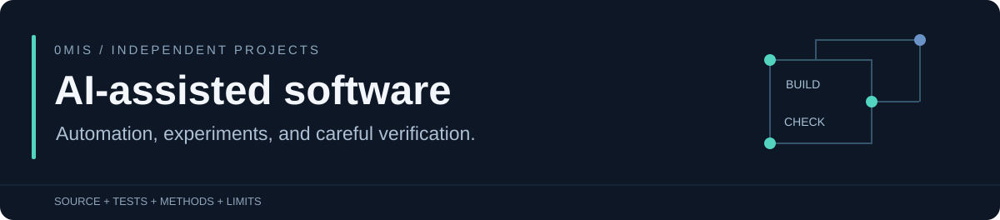

I build practical tools and software experiments with AI coding agents. My work centers on automation, testing, debugging, and making results easy to inspect.

These are independent, substantially AI-assisted projects. I guide the work through planning, prompting, coding, testing, and debugging.

## Selected work

| Project | What you can inspect |
| --- | --- |
| **[Clearfile workflow demo](https://github.com/0mis/clearfile-workflow-demo)** · Python / SQLite | A local quote-to-invoice demonstration with decimal arithmetic, safe retries, transactional numbering, and approval checks. Synthetic data throughout. [Live walkthrough](https://clearfile-workflows-0mis.mrmaymay.chatgpt.site/#work). |
| **[Butter Lab](https://github.com/0mis/butter-lab)** · JavaScript / WebGPU | An interactive heat-and-flow simulation with reference-model checks, GPU health probes, and documented modeling limits. [Try the lab](https://0mis.github.io/butter-lab/). |
| **[Recorded control harness](https://github.com/0mis/worlds-hardest-game-recorded-agent)** · Node.js / Playwright / Python | Bounded actions, request receipts, recording-health gates, and a run audit. [Methods and limitations](https://github.com/0mis/worlds-hardest-game-recorded-agent/blob/main/METHODS.md). |
| **[New Vegas controller](https://github.com/0mis/astra-jev-new-vegas)** · Python | Typed API decisions, conservative budget reservations, telemetry, independent watchdogs, and regression cases from a supervised campaign. [Architecture](https://github.com/0mis/astra-jev-new-vegas/blob/main/ARCHITECTURE.md). |

## More engineering experiments

- **[Super Peasant for Fallout 4](https://github.com/0mis/fallout4-super-peasant)** — native C++ and Papyrus companion mod, with a playable preview, runtime-specific validation, and credited third-party assets.
- **[Left 4 Dead 2 controller](https://github.com/0mis/astra-jev-left4dead2)** — asynchronous decisions, a VScript observation addon, capture controls, and regression cases.
- **[Geometry Dash experiment](https://github.com/0mis/gpt6-astra-geometry-dash)** — a native bridge and Python controllers with state-checked input and recording acknowledgements.

## How I approach the work

Start with a concrete task. Build a small working path, inspect failures, add useful checks, and document what the result supports.

The game experiments use supervision and direct game state; some pause the game while planning. Each repository explains its setup, methods, and limits. The workflow demo uses fictional business data, and Butter Lab is an educational approximation.
